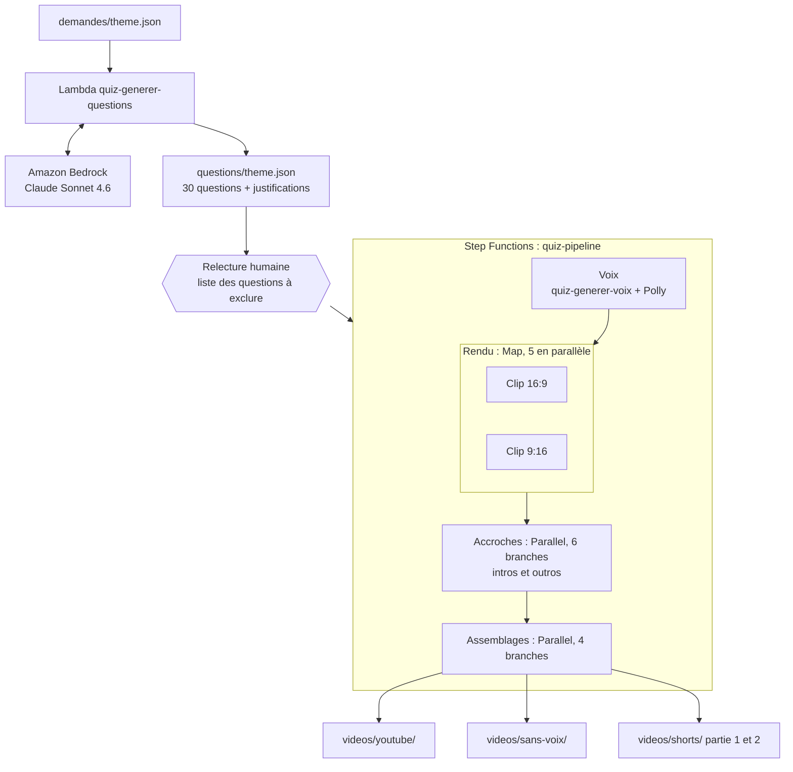

# Master Quiz : pipeline vidéo serverless avec IA générative sur AWS

> **English summary.** Master Quiz is a French quiz channel whose videos are produced end to end by a serverless AWS pipeline. Amazon Bedrock (Claude Sonnet 4.6) writes the questions, a human reviews them, then an AWS Step Functions state machine drives Amazon Polly (text-to-speech) and containerized Lambda functions running FFmpeg and Pillow to render **4 videos per topic** (16:9 YouTube video, two 9:16 Shorts, and a voiceless version). Intermediate files are cleaned up by S3 and ECR lifecycle rules. The pipeline is in production: one topic published every day on YouTube and TikTok, with nearly 10,000 YouTube views in the first four weeks.

**Chaîne YouTube :** [@masterquiz_fr](https://www.youtube.com/@masterquiz_fr) · **TikTok :** [@masterquiz93](https://www.tiktok.com/@masterquiz93)

---

## Sommaire

1. [Le projet en bref](#1-le-projet-en-bref)
2. [Architecture](#2-architecture)
3. [Services AWS utilisés](#3-services-aws-utilisés)
4. [Choix techniques](#4-choix-techniques)
5. [Sécurité](#5-sécurité)
6. [Maîtrise des coûts](#6-maîtrise-des-coûts)
7. [Organisation du bucket S3](#7-organisation-du-bucket-s3)
8. [Structure du dépôt](#8-structure-du-dépôt)
9. [Déploiement et utilisation](#9-déploiement-et-utilisation)
10. [Problèmes rencontrés et solutions](#10-problèmes-rencontrés-et-solutions)
11. [Résultats](#11-résultats)
12. [Améliorations possibles](#12-améliorations-possibles)

---

## 1. Le projet en bref

Master Quiz est une chaîne de quiz vidéo en français (culture générale, années 80/90/2000, cinéma, histoire, géographie…). Toutes les vidéos sont **produites automatiquement** par un pipeline AWS serverless :

1. je choisis un thème ;
2. l'IA (Amazon Bedrock) génère les questions ;
3. je relis et j'écarte celles qui posent problème ;
4. le pipeline produit toutes les vidéos en environ 8 minutes ;
5. je publie à la main sur YouTube et TikTok.

**Chaque thème produit 4 vidéos :**

| Sortie | Format | Contenu |
|---|---|---|
| Vidéo longue YouTube | 16:9, 1920×1080 | 25 questions, environ 8 min |
| Short partie 1 | 9:16, 1080×1920 | questions 1 à 10 |
| Short partie 2 | 9:16, 1080×1920 | questions 11 à 20 |
| Vidéo longue sans voix | 16:9 | même rythme, sans voix de synthèse (pour enregistrer ma propre voix) |

Chaque question suit le même déroulé : question lue, pause, compte à rebours avec tic-tac, puis révélation de la bonne réponse (case en vert, son et annonce vocale), avec une musique de fond qui baisse automatiquement pendant que la voix parle.

---

## 2. Architecture

Le pipeline fonctionne **en deux temps**, avec une **validation humaine au milieu**. Le temps 2 part de questions déjà validées : aucune vidéo n'a besoin d'être corrigée ou réassemblée après coup.



### Temps 1 : génération des questions

`quiz-generer-questions` lit une demande (`{"theme", "difficulte", "nombre"}`), appelle Bedrock une seule fois et écrit `questions/<theme>.json`. Chaque question contient l'énoncé, 4 choix, l'index de la bonne réponse et une **justification** (le fait précis qui prouve la réponse), ce qui accélère beaucoup la relecture.

### Relecture humaine

Je relis le fichier et je note les numéros des questions à écarter (fait douteux, question trop facile, doublon…). Le modèle génère 30 questions pour en garder 25.

### Temps 2 : production des vidéos ([`quiz-pipeline.asl.json`](step-functions/quiz-pipeline.asl.json))

| Étape | Type | Rôle |
|---|---|---|
| **Voix** | Task | `quiz-generer-voix` applique les exclusions, écrit `questions/<theme>-final.json`, puis fait lire chaque question et chaque réponse par Polly (voix Rémi) |
| **Rendu** | Map (MaxConcurrency 5) + Parallel | pour chaque question, `quiz-rendu-clip` produit en parallèle le clip 16:9 (et sa copie sans voix) et le clip 9:16 |
| **Accroches** | Parallel, 6 branches | intros et outros animées (voix Léa) : YouTube, short partie 1, short partie 2 |
| **Assemblages** | Parallel, 4 branches | `quiz-assembler` colle intro, clips et outro, ajoute la pastille « QUESTION k/N » et la musique, puis écrit les 4 vidéos finales |

---

## 3. Services AWS utilisés

| Service | Utilisation |
|---|---|
| **AWS Step Functions** | Orchestration du temps 2 (machine à états Standard, états Map, Parallel et Retry) |
| **AWS Lambda** | 2 fonctions Python en zip, 2 fonctions sur image de conteneur |
| **Amazon ECR** | Dépôt `quiz-rendu` : image Lambda avec FFmpeg, Pillow et polices |
| **Amazon Bedrock** | Génération des questions avec Claude Sonnet 4.6 (profil d'inférence `eu.anthropic.claude-sonnet-4-6`), API Converse |
| **Amazon Polly** | Synthèse vocale neural `fr-FR` : Rémi pour les questions, Léa pour les intros et outros |
| **Amazon S3** | Stockage de tout le pipeline, avec règles de cycle de vie |
| **AWS IAM** | Rôle d'exécution des Lambda limité au bucket, rôle Step Functions limité aux 3 fonctions appelées |
| **Amazon CloudWatch Logs** | Journaux des Lambda |

Région : `eu-central-1` (Francfort).

| Lambda | Package | Mémoire | Timeout | Remarque |
|---|---|---|---|---|
| `quiz-generer-questions` | zip, Python | 128 Mo | 3 min | appel Bedrock |
| `quiz-generer-voix` | zip, Python | 128 Mo | 3 min | appels Polly |
| `quiz-rendu-clip` | image ECR, `app.lambda_handler` | 2048 Mo | 3 min | rendu FFmpeg d'un clip |
| `quiz-assembler` | même image, `assembler.lambda_handler` | 3008 Mo | 10 min | 2048 Mo de stockage éphémère |

---

## 4. Choix techniques

**Pipeline en deux temps avec validation humaine.** Le modèle se trompe environ 5 fois sur 30. Valider les questions *avant* le rendu évite de supprimer des clips et de réassembler les vidéos. Relancer un temps 1 coûte quelques centimes, relancer un rendu complet coûte beaucoup plus.

**Fichier source immuable.** Le fichier généré par Bedrock n'est jamais modifié : `quiz-generer-voix` en tire une version `-final.json`. On peut donc relancer le temps 2 avec une autre liste d'exclusions sans régénérer les questions.

**Fiabiliser la sortie du modèle, sans lui faire confiance aveuglément.**
- un prompt strict (exactitude, mauvaises réponses crédibles, longueurs maximales, variété, sujets sensibles exclus) et une justification obligatoire ;
- une température basse (0.1) et une marge de 10 questions ;
- un **contrôle en Python** (`est_valide`) qui rejette les questions mal formées, trop longues, avec des choix en double ou une bonne réponse déjà utilisée ;
- le **mélange des choix en Python** : le modèle plaçait toujours la bonne réponse au même endroit.

**Une seule image Docker pour deux fonctions.** `quiz-rendu-clip` et `quiz-assembler` partagent la même image et ne diffèrent que par la commande (`app.lambda_handler` ou `assembler.lambda_handler`). Un seul build, une seule dépendance FFmpeg à maintenir.

**Parallélisme maîtrisé et résilience.**
- le Map est limité à 5 exécutions simultanées pour ne pas saturer la concurrence Lambda du compte ;
- chaque tâche a un `Retry` avec backoff exponentiel (3 s, ×2, 4 tentatives) sur `Lambda.TooManyRequestsException` et `Lambda.ServiceException` ;
- le Map renvoie `ResultPath: null` pour ne pas faire grossir l'état transmis aux étapes suivantes.

**Configuration hors du code.** Le nom du bucket passe dans l'événement d'entrée, le modèle Bedrock et les voix Polly dans des variables d'environnement (`MODEL_ID`, `VOIX`, `NB_MAX`). Le code ne contient aucun identifiant de compte ni nom de ressource.

**Rendu vidéo.**
- les éléments graphiques (cases, bandeau, logo, grille de score) sont dessinés avec Pillow et superposés par FFmpeg, et le texte est écrit par `drawtext` ;
- les intros et outros sont animées image par image (zoom et fondu) avec Pillow ;
- des espaces insécables empêchent un « ? », un « ! » ou un guillemet de se retrouver seul en début de ligne ;
- la musique baisse automatiquement sous la voix (*ducking* avec `sidechaincompress`) ;
- la pastille « QUESTION k/N » est une petite image par question, superposée seulement pendant son clip : c'est ce qui a résolu un `Runtime.OutOfMemory` de l'assembleur.

---

## 5. Sécurité

- **Aucun secret dans le code.** Pas de clé d'accès : les Lambda utilisent leur rôle d'exécution IAM.
- **Rôle des Lambda limité** ([`lambda-role-quiz-pipeline-access.json`](infra/iam/lambda-role-quiz-pipeline-access.json)) : actions S3 restreintes **au seul bucket du projet**, `bedrock:InvokeModel` uniquement (pas d'administration Bedrock), `polly:SynthesizeSpeech` uniquement, plus la politique gérée `AWSLambdaBasicExecutionRole` pour les journaux. Aucune politique `FullAccess`.
- **Accès Marketplace** ([`lambda-role-bedrock-marketplace.json`](infra/iam/lambda-role-bedrock-marketplace.json)) : nécessaire au premier accès aux modèles Anthropic sur Bedrock.
- **Rôle Step Functions limité** ([`step-functions-policy.json`](infra/iam/step-functions-policy.json)) : `lambda:InvokeFunction` uniquement sur les 3 fonctions appelées par la machine à états.
- **Bucket privé** : les vidéos sont récupérées avec des URL présignées à durée limitée (1 h).
- **Région unique** en Europe, et un profil d'inférence Bedrock `eu.` qui garde les appels sur des régions européennes.

---

## 6. Maîtrise des coûts

- **100 % serverless** : on ne paie qu'à l'exécution, rien ne tourne entre deux thèmes.
- **4 règles de cycle de vie S3** ([`s3-lifecycle.json`](infra/s3-lifecycle.json)) suppriment les fichiers intermédiaires (`voix/`, `clips/`, `clips-sans-voix/`, `clips-shorts/`) après 7 jours.
- **Une règle de cycle de vie ECR** ([`ecr-lifecycle.json`](infra/ecr-lifecycle.json)) supprime les images sans tag après 1 jour : chaque nouveau build libère l'ancienne image.
- **Un seul appel Bedrock par thème**. Une deuxième passe de vérification automatique a été conçue, puis volontairement écartée pour garder des coûts bas : la relecture humaine la remplace.

---

## 7. Organisation du bucket S3

| Préfixe | Contenu | Durée de vie |
|---|---|---|
| `demandes/` | Demandes : thème, difficulté, nombre | conservé |
| `questions/` | `<theme>.json` (brut Bedrock, jamais modifié) et `<theme>-final.json` | conservé |
| `voix/<theme>/` | MP3 Polly | 7 jours |
| `clips/<theme>/` | Clips YouTube : `a_intro.mp4`, `clip_NN.mp4`, `z_outro.mp4` | 7 jours |
| `clips-sans-voix/<theme>/` | Mêmes clips, sans la voix | 7 jours |
| `clips-shorts/<theme>/` | Clips 9:16, avec `a_intro_p1/_p2` et `z_outro_p1/_p2` | 7 jours |
| `videos/youtube/`, `videos/sans-voix/`, `videos/shorts/` | Vidéos finales | conservé |
| `assets/` | `fond.jpg`, `logo.png`, `musique.mp3`, `tic.mp3`, `bonne.mp3` | conservé |

Les préfixes `a_` et `z_` garantissent que l'intro et l'outro sont triées avant et après les clips lors de l'assemblage.

---

## 8. Structure du dépôt

```
projet-04-master-quiz-pipeline/
├── lambdas/
│   ├── generer-questions/lambda_function.py   Temps 1 : Bedrock + contrôle des questions
│   └── generer-voix/lambda_function.py        Exclusions + voix Polly
├── rendu/
│   ├── Dockerfile                             Image Lambda : Python 3.13 + FFmpeg + Pillow
│   ├── app.py                                 Rendu d'un clip, d'une intro ou d'une outro
│   └── assembler.py                           Assemblage des vidéos finales
├── step-functions/
│   └── quiz-pipeline.asl.json                 Définition de la machine à états
├── infra/
│   ├── iam/                                   Politiques IAM des rôles
│   ├── s3-lifecycle.json                      Cycle de vie S3
│   └── ecr-lifecycle.json                     Cycle de vie ECR
└── exemples/                                  Demande, entrées et extrait de questions
```

Les fichiers média (`assets/`) ne sont pas versionnés : musique, fond et logo sont soumis à des droits ou propres à la chaîne. Ils sont à déposer dans `s3://<BUCKET>/assets/`.

---

## 9. Déploiement et utilisation

Dans les commandes ci-dessous, remplacez `<BUCKET>` par le nom de votre bucket et `<ACCOUNT_ID>` par l'identifiant de votre compte AWS.

### Prérequis

- un compte AWS avec accès à Claude Sonnet 4.6 sur Bedrock, en `eu-central-1` (formulaire de cas d'usage Anthropic à remplir une fois par compte) ;
- AWS CLI et Docker Desktop ;
- un bucket S3 privé contenant le dossier `assets/`.

### Construire et publier l'image de rendu

```powershell
aws ecr get-login-password --region eu-central-1 | docker login --username AWS --password-stdin <ACCOUNT_ID>.dkr.ecr.eu-central-1.amazonaws.com
docker build --platform linux/amd64 --provenance=false -t <ACCOUNT_ID>.dkr.ecr.eu-central-1.amazonaws.com/quiz-rendu:latest rendu/
docker push <ACCOUNT_ID>.dkr.ecr.eu-central-1.amazonaws.com/quiz-rendu:latest
```

Puis « Déployer une nouvelle image » sur `quiz-rendu-clip` **et** `quiz-assembler`.

### Produire un thème (PowerShell)

```powershell
# TEMPS 1 : générer les questions
[IO.File]::WriteAllText("$PWD\animaux.json", '{"theme": "Les animaux", "difficulte": "moyenne", "nombre": 30}')
aws s3 cp animaux.json s3://<BUCKET>/demandes/
[IO.File]::WriteAllText("$PWD\entree.json", '{"bucket": "<BUCKET>", "demande": "demandes/animaux.json"}')
aws lambda invoke --region eu-central-1 --cli-read-timeout 300 --function-name quiz-generer-questions --payload fileb://entree.json out.json
aws s3 cp s3://<BUCKET>/questions/animaux.json .

# RELECTURE : noter les numéros à exclure (index 0 = 1re question, 5 au maximum)

# TEMPS 2 : produire les vidéos
[IO.File]::WriteAllText("$PWD\entree.json", '{"bucket": "<BUCKET>", "questions": "questions/animaux.json", "exclure": [4, 6, 7, 14, 23]}')
aws stepfunctions start-execution --region eu-central-1 --state-machine-arn arn:aws:states:eu-central-1:<ACCOUNT_ID>:stateMachine:quiz-pipeline --input file://entree.json

# RÉCUPÉRATION
aws s3 cp s3://<BUCKET>/videos/youtube/animaux.mp4 .
aws s3 presign s3://<BUCKET>/videos/shorts/animaux-partie1.mp4 --region eu-central-1 --expires-in 3600
```

`[IO.File]::WriteAllText` évite le BOM UTF-8 qu'ajoute PowerShell et qui casse le JSON. Le thème doit rester court (2 à 4 mots), car il est affiché et lu tel quel dans l'intro.

Des exemples de fichiers d'entrée se trouvent dans [`exemples/`](exemples/).

---

## 10. Problèmes rencontrés et solutions

| Problème | Solution |
|---|---|
| FFmpeg « no such filter drawtext » | Build FFmpeg statique BtbN (version gpl complète) |
| `drawtext` : police introuvable, système de fichiers en lecture seule | Police DejaVu installée dans l'image (seul `/tmp` est inscriptible en Lambda) |
| Bedrock `AccessDeniedException` (Marketplace) | Politique IAM Marketplace + formulaire de cas d'usage Anthropic |
| Anciens modèles Bedrock retirés | Profil d'inférence `eu.anthropic.claude-sonnet-4-6` |
| Bonne réponse toujours à la même place | Mélange des choix en Python |
| JSON invalide (`Unrecognized token 'ï'`) | BOM PowerShell : `[IO.File]::WriteAllText` |
| `Runtime.OutOfMemory` dans l'assembleur | Une petite image par pastille au lieu d'une séquence d'images plein écran |
| `apad` infini sur la copie sans voix | Durée forcée avec `-t` |
| Accent anglais de Polly sur les noms propres | `LanguageCode="fr-FR"` forcé |
| Session Docker expirée (403 sur ECR) | Nouvelle connexion avec `aws ecr get-login-password` |
| Guillemet ou ponctuation seule en début de ligne | Espaces insécables |
| Logo qui chevauche l'outro, écran de fin YouTube masqué | Outro décalée sur la moitié gauche |
| Revendication Content ID sur la musique | Musique remplacée, vidéos testées en privé avant publication |
| Erreurs factuelles des questions (environ 5 sur 30) | Prompt strict, justification, température 0.1, marge de 10, relecture humaine |
| Corrections lourdes après rendu (suppression de clips, réassemblage) | Pipeline en deux temps avec liste `exclure` |

---

## 11. Résultats

Première vidéo publiée le 7 novembre 2026. Un thème par jour depuis, sur YouTube et TikTok.

**YouTube, 28 premiers jours :**
- **9 800 vues** et **112 h de visionnage** ;
- **35 abonnés** ;
- meilleur short : **1 400 vues** (histoire de France, partie 2).

Thèmes publiés : culture générale, années 80, 90 et 2000, films cultes, séries cultes, Disney et Pixar, football, géographie, histoire de France, animaux…

---

## 12. Améliorations possibles

- **Infrastructure as Code** : décrire tout le pipeline avec Terraform ou AWS SAM pour le redéployer en une commande.
- **CI/CD** : build et déploiement automatiques de l'image et des Lambda avec GitHub Actions (authentification OIDC, sans clé d'accès).
- **Un rôle IAM par Lambda**, chacun limité à ses préfixes S3. Retirer `s3:DeleteObject` (les suppressions sont faites par le cycle de vie), restreindre Bedrock au seul modèle utilisé et retirer les droits Marketplace, qui ne servent qu'au premier abonnement.
- **Build reproductible** : figer les versions de FFmpeg et de Pillow dans le Dockerfile.
- **Déclenchement automatique** du temps 1 par EventBridge à l'arrivée d'une demande dans S3.
- **Mémoire des questions déjà posées** : transmettre au modèle les questions des thèmes précédents pour éviter les répétitions.
- **Vérification automatique** des faits par un second appel Bedrock, si le volume le justifie.

---

## Auteur

**Jimmy Barbier**, Cloud Engineer junior, certifié AWS Cloud Practitioner, Azure Fundamentals et Google Cloud Digital Leader.

[Portfolio](https://jimmy-barbier.github.io/portfolio) · [LinkedIn](https://www.linkedin.com/in/jimmy-barbier-89740539a/) · [GitHub](https://github.com/Jimmy-Barbier)
