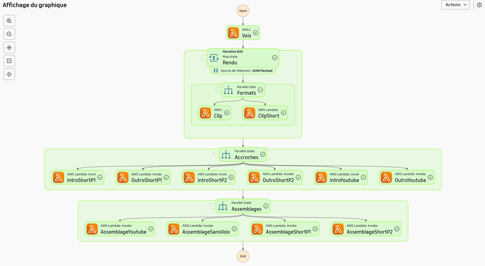

# 🎬 Master Quiz : pipeline vidéo serverless avec IA générative sur AWS

## 📋 Description

Je regarde moi-même beaucoup de vidéos de quiz sur YouTube. En y regardant de plus près, je me suis rendu compte que le format est très répétitif : une question, quatre choix, un compte à rebours, la réponse. Autrement dit, un format idéal pour l'automatisation.

J'en ai fait un projet concret : une vraie chaîne de quiz, **Master Quiz**, dont toutes les vidéos sont produites par un pipeline **AWS serverless**. C'était l'occasion de mettre en pratique des services que je n'avais pas encore manipulés : **AWS Step Functions** pour l'orchestration, **Amazon Bedrock** pour l'IA générative, **Amazon Polly** pour la synthèse vocale, et des **fonctions Lambda sur image de conteneur** pour le rendu vidéo avec FFmpeg.

Le projet est construit **à la main dans la console AWS et en ligne de commande**, et il tourne **en production** : un thème est publié chaque jour sur YouTube et TikTok.

> 💡 **Comment ça marche en une phrase ?** Je choisis un thème, Bedrock rédige les questions, je les relis, puis une machine à états Step Functions fait lire les questions par Polly, rend chaque clip avec FFmpeg dans des Lambda en parallèle et assemble **3 vidéos prêtes à publier**, le tout en environ 5 à 6 minutes.

**Chaîne YouTube :** [@masterquiz_fr](https://www.youtube.com/@masterquiz_fr) · **TikTok :** [@masterquiz93](https://www.tiktok.com/@masterquiz93)

> 🇬🇧 **English summary.** Master Quiz is a French quiz channel whose videos are produced end to end by a serverless AWS pipeline. Amazon Bedrock (Claude Sonnet 4.6) writes the questions, a human reviews them, then an AWS Step Functions state machine drives Amazon Polly and containerized Lambda functions (FFmpeg + Pillow) to render 4 videos per topic. In production since November 2026, with nearly 10,000 YouTube views in the first four weeks.

---

## 🏛️ Architecture

Le pipeline fonctionne **en deux temps**, avec une **validation humaine au milieu** : les vidéos ne sont produites qu'à partir de questions déjà validées.

```
TEMPS 1 : GÉNÉRATION DES QUESTIONS
──────────────────────────────────

Moi
 │
 │ dépose demandes/<theme>.json
 ▼
┌─────────────────────────────┐        ┌──────────────────────────┐
│ Lambda                      │──────▶ │ Amazon Bedrock           │
│ quiz-generer-questions      │◀────── │ Claude Sonnet 4.6        │
│ Python · 12 Mo · 3 min     │        │ profil eu. (Converse)    │
└─────────────────────────────┘        └──────────────────────────┘
 │
 │ contrôle Python + mélange des choix
 ▼
┌─────────────────────────────┐
│ S3 questions/<theme>.json   │
│ 30 questions + justification│
└─────────────────────────────┘
 │
 ▼
👤 RELECTURE HUMAINE : liste des questions à exclure

TEMPS 2 : PRODUCTION (Step Functions « quiz-pipeline »)
───────────────────────────────────────────────────────

┌─────────────────────────────┐        ┌──────────────────────────┐
│ Voix                        │──────▶ │ Amazon Polly             │
│ Lambda quiz-generer-voix    │        │ neural fr-FR (Rémi)      │
└─────────────────────────────┘        └──────────────────────────┘
 │
 ▼
┌─────────────────────────────────────────────────────────┐
│ Rendu : Map (5 en parallèle), une itération/question    │
│   ├─ Clip       16:9  ─┐                                │
│   └─ ClipShort   9:16 ─┴─ Lambda quiz-rendu-clip        │
│                           (image ECR : FFmpeg + Pillow) │
└─────────────────────────────────────────────────────────┘
 │
 ▼
┌─────────────────────────────────────────────────────────┐
│ Accroches : Parallel, 6 branches                        │
│   intros et outros animées (voix Léa)                   │
└─────────────────────────────────────────────────────────┘
 │
 ▼
┌─────────────────────────────────────────────────────────┐
│ Assemblages : Parallel, 4 branches                      │
│   Lambda quiz-assembler (même image ECR)                │
└─────────────────────────────────────────────────────────┘
 │
 ▼
┌─────────────────────────────┐
│ S3 videos/                  │
│ youtube · sans-voix · shorts│
└─────────────────────────────┘
```

**Chaque thème produit 4 vidéos :**

| Sortie | Format | Contenu |
|---|---|---|
| Vidéo longue YouTube | 16:9, 1920×1080 | 25 questions, environ 8 min |
| Short partie 1 | 9:16, 1080×1920 | questions 1 à 10 |
| Short partie 2 | 9:16, 1080×1920 | questions 11 à 20 |
| Vidéo longue sans voix | 16:9 | même rythme, sans voix de synthèse |

---

## ⚙️ Stack technique

| Composant | Service AWS | Détail |
|---|---|---|
| Orchestration | AWS Step Functions | Machine à états Standard : Map, Parallel, Retry |
| Génération des questions | Lambda + Amazon Bedrock | Claude Sonnet 4.6, profil d'inférence `eu.anthropic.claude-sonnet-4-6`, température 0.1 |
| Synthèse vocale | Lambda + Amazon Polly | Moteur neural `fr-FR` : Rémi (questions), Léa (intros et outros) |
| Rendu des clips | Lambda sur image de conteneur | FFmpeg statique + Pillow, 2048 Mo / 3 min |
| Assemblage | Lambda sur la même image | 3008 Mo / 10 min, 2048 Mo de stockage éphémère |
| Registre d'images | Amazon ECR | Dépôt `quiz-rendu`, image `public.ecr.aws/lambda/python:3.13` |
| Stockage | Amazon S3 | Demandes, questions, voix, clips, vidéos finales, assets |
| Sécurité IAM | Rôles + politiques ciblées | Bucket du projet uniquement, Step Functions limité à 3 fonctions |
| Journaux | CloudWatch Logs | Logs des 4 Lambda |

Région : **eu-central-1 (Francfort)**.

---

## 📁 Structure du projet

```
projet-04-master-quiz-pipeline/
├── README.md
├── lambdas/
│   ├── generer-questions/
│   │   └── lambda_function.py     # Temps 1 : Bedrock + contrôle des questions
│   └── generer-voix/
│       └── lambda_function.py     # Exclusions + voix Polly
├── rendu/
│   ├── Dockerfile                 # Image Lambda : Python 3.13 + FFmpeg + Pillow
│   ├── app.py                     # Rendu d'un clip, d'une intro ou d'une outro
│   └── assembler.py               # Assemblage des 4 vidéos finales
├── step-functions/
│   └── quiz-pipeline.asl.json     # Définition de la machine à états
├── infra/
│   ├── iam/                       # Politiques IAM des rôles
│   ├── s3-lifecycle.json          # Cycle de vie S3
│   └── ecr-lifecycle.json         # Cycle de vie ECR
├── exemples/                      # Demande, entrées et extrait de questions
└── assets/
    └── step-functions-graph.png   # Exécution réussie de la machine à états
```

---

## 🛠️ Prérequis

- Compte AWS actif, région **eu-central-1 (Francfort)**
- Accès à **Claude Sonnet 4.6** sur Amazon Bedrock (formulaire de cas d'usage Anthropic à remplir une fois par compte)
- AWS CLI et Docker Desktop
- Un bucket S3 privé contenant les fichiers média dans `assets/` : `fond.jpg`, `logo.png`, `musique.mp3`, `tic.mp3`, `bonne.mp3`

> 💡 **Pourquoi les fichiers média ne sont-ils pas dans le dépôt ?** La musique, les sons, le fond et le logo sont soumis à des droits ou propres à la chaîne. Le pipeline les lit directement dans le bucket S3.

---

## ⚙️ Configuration

Le nom du bucket est transmis dans l'événement d'entrée. Le reste passe par des variables d'environnement :

| Variable | Lambda | Description |
|---|---|---|
| `MODEL_ID` | `quiz-generer-questions` | Identifiant du modèle Bedrock (profil `eu.anthropic.claude-sonnet-4-6`) |
| `VOIX` | `quiz-generer-voix` | Voix Polly des questions (par défaut `Remi`) |
| `NB_MAX` | `quiz-generer-voix` | Nombre de questions gardées pour la vidéo (par défaut `25`) |
| `VOIX` | `quiz-rendu-clip` | Voix Polly des intros et outros (par défaut `Lea`) |

> ⚠️ **Aucune valeur sensible n'est codée en dur** : ni identifiant de compte, ni nom de bucket, ni clé d'accès. Les Lambda utilisent leur rôle IAM.

---

## 🚀 Déploiement

Ce projet a été construit pas à pas dans la console AWS et avec la CLI :

1. Création du bucket S3 privé et dépôt des fichiers média dans `assets/`
2. Ajout des 4 règles de cycle de vie S3 ([`s3-lifecycle.json`](infra/s3-lifecycle.json))
3. Création du rôle IAM des Lambda et de ses politiques ([`infra/iam/`](infra/iam/))
4. Création des 2 Lambda Python en zip : `quiz-generer-questions` et `quiz-generer-voix`
5. Création du dépôt ECR `quiz-rendu` et de sa règle de cycle de vie ([`ecr-lifecycle.json`](infra/ecr-lifecycle.json))
6. Build et push de l'image de rendu :
   ```powershell
   aws ecr get-login-password --region eu-central-1 | docker login --username AWS --password-stdin <ACCOUNT_ID>.dkr.ecr.eu-central-1.amazonaws.com
   docker build --platform linux/amd64 --provenance=false -t <ACCOUNT_ID>.dkr.ecr.eu-central-1.amazonaws.com/quiz-rendu:latest rendu/
   docker push <ACCOUNT_ID>.dkr.ecr.eu-central-1.amazonaws.com/quiz-rendu:latest
   ```
7. Création des 2 Lambda sur cette image : `quiz-rendu-clip` (commande `app.lambda_handler`) et `quiz-assembler` (commande `assembler.lambda_handler`)
8. Création de la machine à états `quiz-pipeline` ([`quiz-pipeline.asl.json`](step-functions/quiz-pipeline.asl.json))

### Utilisation (PowerShell)

```powershell
# TEMPS 1 : générer les questions
[IO.File]::WriteAllText("$PWD\animaux.json", '{"theme": "Les animaux", "difficulte": "moyenne", "nombre": 30}')
aws s3 cp animaux.json s3://<BUCKET>/demandes/
[IO.File]::WriteAllText("$PWD\entree.json", '{"bucket": "<BUCKET>", "demande": "demandes/animaux.json"}')
aws lambda invoke --region eu-central-1 --cli-read-timeout 300 --function-name quiz-generer-questions --payload fileb://entree.json out.json
aws s3 cp s3://<BUCKET>/questions/animaux.json .

# RELECTURE : noter les numéros à exclure (index 0 = 1re question, 5 au maximum)

# TEMPS 2 : produire les vidéos
[IO.File]::WriteAllText("$PWD\entree.json", '{"bucket": "<BUCKET>", "questions": "questions/animaux.json", "exclure": [4, 6, 7, 14, 23]}')
aws stepfunctions start-execution --region eu-central-1 --state-machine-arn arn:aws:states:eu-central-1:<ACCOUNT_ID>:stateMachine:quiz-pipeline --input file://entree.json

# RÉCUPÉRATION
aws s3 cp s3://<BUCKET>/videos/youtube/animaux.mp4 .
aws s3 presign s3://<BUCKET>/videos/shorts/animaux-partie1.mp4 --region eu-central-1 --expires-in 3600
```

---

## ✅ Résultats

### Exécution de la machine à états


*Exécution réussie de bout en bout : voix, rendu de 25 questions en 2 formats, 6 accroches et 4 assemblages en parallèle.*

### Audience (28 premiers jours)

| Indicateur | Valeur |
|---|---|
| Première vidéo publiée | 7 novembre 2026 |
| Rythme | 1 thème par jour (2 shorts + 1 vidéo longue) |
| Vues YouTube | **9 800** |
| Durée de visionnage | **112 h** |
| Abonnés YouTube | **35** |
| Meilleur short | **1 400 vues** (histoire de France, partie 2) |

---

## 🔐 Sécurité

Dans une logique de **security by design**, le pipeline ne donne à chaque composant que les droits dont il a besoin :

| Composant | Mesure de sécurité |
|---|---|
| Rôle des Lambda | Actions S3 limitées **au seul bucket du projet**, `bedrock:InvokeModel` et `polly:SynthesizeSpeech` uniquement, aucune politique `FullAccess` |
| Rôle Step Functions | `lambda:InvokeFunction` limité aux **3 fonctions** appelées par la machine à états |
| Secrets | Aucune clé d'accès : les Lambda utilisent leur rôle IAM |
| Configuration | Bucket dans l'événement, modèle et voix en variables d'environnement, rien en dur |
| Bucket S3 | Privé, vidéos récupérées par URL présignée valable 1 h |
| Minimisation des données | Fichiers intermédiaires supprimés automatiquement après 7 jours |
| Région | Tout en Europe (eu-central-1), profil d'inférence Bedrock `eu.` |

---

## 📤 Sortie des fonctions Lambda

| Lambda | Sortie |
|---|---|
| `quiz-generer-questions` | `{"bucket", "questions", "nombre"}` : chemin du fichier de questions et nombre gardé |
| `quiz-generer-voix` | `{"bucket", "nom", "voix", "nombre", "index"}` : la liste `index` alimente le Map |
| `quiz-rendu-clip` | `{"clip"}` : clé S3 du clip produit (`null` si la question n'est pas rendue pour ce format) |
| `quiz-assembler` | `{"video", "clips", "questions"}` : clé S3 de la vidéo finale |

---

## 🔧 Difficultés rencontrées

Ce projet n'a pas fonctionné du premier coup. Voici les vrais blocages rencontrés, et comment ils ont été résolus.

**1. FFmpeg : « No such filter: drawtext »**
- **Symptôme** : le rendu plante dès qu'il faut écrire la question sur l'image.
- **Cause** : le FFmpeg installé ne contenait pas le filtre `drawtext`.
- **Solution** : passage à la build statique complète de BtbN (version gpl), téléchargée dans le Dockerfile.

**2. Police introuvable dans la Lambda**
- **Symptôme** : `drawtext` ne trouve aucune police.
- **Cause** : l'image Lambda n'en contient pas, et seul `/tmp` est inscriptible à l'exécution.
- **Solution** : installation des polices DejaVu dans l'image Docker, au moment du build.

**3. `AccessDeniedException` sur Bedrock**
- **Symptôme** : le premier appel au modèle Anthropic est refusé malgré `bedrock:InvokeModel`.
- **Cause** : les modèles Anthropic passent par un abonnement AWS Marketplace, et le formulaire de cas d'usage n'avait pas été rempli.
- **Solution** : politique IAM Marketplace (`ViewSubscriptions`, `Subscribe`) + formulaire Anthropic rempli une fois pour le compte. Les anciens modèles ayant été retirés, le pipeline utilise le profil d'inférence `eu.anthropic.claude-sonnet-4-6`.

**4. La bonne réponse toujours au même endroit**
- **Symptôme** : sur une vidéo, la bonne réponse était presque toujours la A.
- **Cause** : le modèle place spontanément la bonne réponse en premier.
- **Solution** : le prompt impose la bonne réponse en premier, puis les choix sont **mélangés en Python** et l'index de la bonne réponse est recalculé.

**5. `Runtime.OutOfMemory` dans l'assembleur**
- **Symptôme** : l'assemblage plante après l'ajout de la pastille « QUESTION k/N ».
- **Cause** : la pastille était générée comme une séquence d'images plein écran, beaucoup trop lourde en mémoire.
- **Solution** : une seule petite image PNG par question, superposée par FFmpeg uniquement pendant la durée de son clip.

**6. JSON invalide (`Unrecognized token 'ï'`)**
- **Symptôme** : la Lambda refuse le fichier d'entrée créé sous Windows.
- **Cause** : PowerShell ajoute un BOM UTF-8 au début des fichiers.
- **Solution** : création des fichiers avec `[IO.File]::WriteAllText`, qui n'ajoute pas de BOM.

**7. Erreurs factuelles dans les questions**
- **Symptôme** : environ 5 questions sur 30 contenaient une erreur ou une réponse discutable, découvertes après le rendu.
- **Cause** : un modèle de langage peut se tromper avec assurance, et corriger après coup obligeait à supprimer des clips et à réassembler.
- **Solution** : prompt strict avec **justification obligatoire**, température 0.1, marge de 10 questions, contrôle Python, puis passage à un **pipeline en deux temps** : la relecture humaine se fait avant le rendu, avec une simple liste `exclure`.

---

## 🐛 Limites connues

- **Relecture humaine indispensable** : malgré le prompt et les contrôles, le modèle se trompe encore sur quelques questions par thème
- **Répétitions entre thèmes** : le modèle ne connaît pas les questions déjà posées dans les vidéos précédentes
- **Publication manuelle** : la mise en ligne sur YouTube et TikTok reste faite à la main
- **Build non figé** : le Dockerfile télécharge la dernière version de FFmpeg, le build peut donc varier dans le temps
- **Thème court obligatoire** : il est affiché et lu tel quel dans l'intro (2 à 4 mots, sans apostrophe à cause de PowerShell)

---

## 🗺️ Évolutions prévues

**Fonctionnel**
- [ ] Mémoire des questions déjà posées, transmise au modèle pour éviter les répétitions
- [ ] Déclenchement automatique du temps 1 par EventBridge à l'arrivée d'une demande dans S3
- [ ] Voix plus expressive (ElevenLabs) ou ma propre voix grâce à la version sans voix
- [ ] Quiz en images (drapeaux, emojis, photos libres de droits)

**Sécurité**
- [ ] Un rôle IAM par Lambda, chacun limité à ses préfixes S3
- [ ] Retrait de `s3:DeleteObject` (les suppressions sont faites par le cycle de vie) et des droits Marketplace, qui ne servent qu'au premier abonnement
- [ ] Bedrock restreint au seul modèle utilisé

**Infrastructure**
- [ ] Version Terraform ou AWS SAM de tout le pipeline
- [ ] CI/CD GitHub Actions (authentification OIDC) pour builder l'image et déployer les Lambda
- [ ] Versions de FFmpeg et Pillow figées dans le Dockerfile

---

## 👤 Auteur

**Jimmy Barbier**
Cloud Engineer AWS en reconversion | Sécurité Cloud | Remote

[](https://www.linkedin.com/in/jimmy-barbier-89740539a/)
[](https://jimmy-barbier.github.io/portfolio/)
